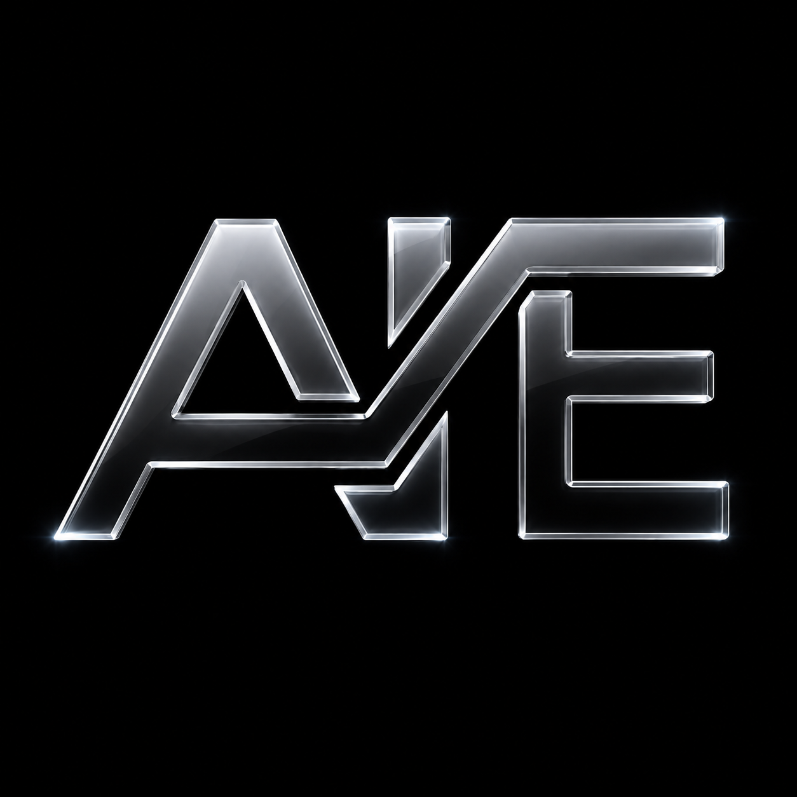
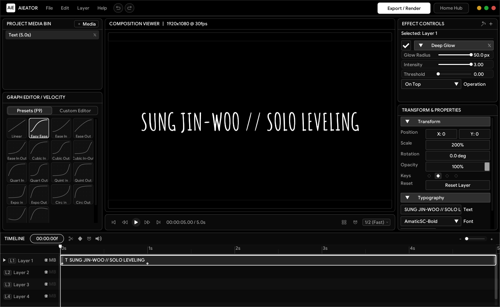
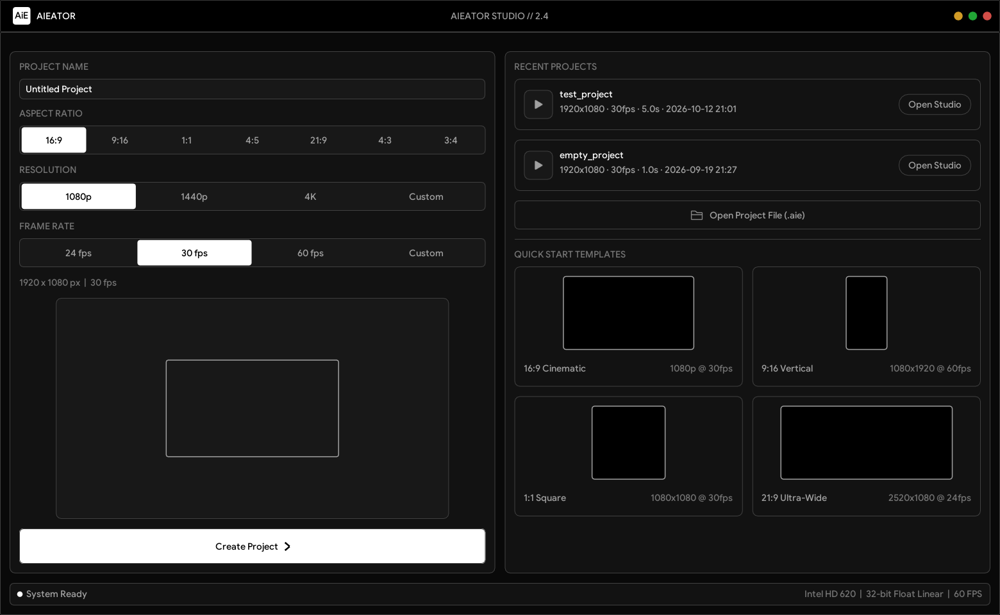

<p align="center">
  
</p>

<h1 align="center">Aieator</h1>

<p align="center">
  <b>A lightweight, standalone CPU-rendered motion graphics and video compositor built for anime and car edits.</b><br>
  <i>Delivering the professional After Effects workflow with none of the bloat.</i>
</p>

<p align="center">
  
  
  
  
  
  
</p>

---

## ⚡ Overview

**Aieator** is a zero-dependency, ultra-portable motion graphics and video editing workstation created for editors who want the exact precision of Adobe After Effects — layers, diamond keyframing, graph velocity editor, motion blur, and effects — without waiting 30 seconds for a splash screen or burning 16 GB of RAM.

Compiled into a **single ~3.0 MB portable executable**, Aieator requires **zero external DLLs** and **no FFmpeg installation**. It leverages native **Windows Media Foundation** for video decoding and H.264 MP4 encoding, custom **GDI typography**, and **Dear ImGui** rendered over OpenGL.

> **Target Hardware Floor:** Runs smoothly on virtually any machine, even an Intel Core i3-4005U with 4GB DDR3.

---

## 📸 Screenshots

### 🎬 Studio Editor
*Composition Viewer, Multi-Track Timeline, 18-Preset Graph Editor, Effect Controls, and Typography.*
<p align="center">
  
</p>

### 🏠 Project Hub & Launcher
*Aspect ratio selector (16:9, 9:16, 1:1, 4:5, 21:9, 4:3, 3:4), resolution presets up to 4K, recent projects, and quick-start templates.*
<p align="center">
  
</p>

---

## ✨ Features

- 🚀 **~3.0 MB Standalone Binary**: Instant startup. Zero installer, no FFmpeg DLLs, no Electron, and no background services.
- ⏱️ **AE-Accurate Timeline & Keyframing**:
  - Independent per-property diamond keyframes (Position, Scale, Rotation, Opacity).
  - Twirl-down tracks with visual diamond badges.
  - Easy Ease stamp (`F9`), snap-to-scrub playhead, markers (`M`), and work-area looping (`I`/`O`/`X`).
- 📈 **Graph Velocity & Easing Editor**:
  - **18 Instant Easing Presets**: Linear, Easy Ease, Cubic, Quart, Quint, Expo, Circ, Back (In / Out / In-Out).
  - **Custom Cubic Bezier Editor**: Interactive tangent handles with clamped curve visualization.
- 🌀 **Multi-Tap Motion Blur**:
  - Temporal directional blur with configurable shutter angles (up to 720°).
  - Weighted accumulation that preserves reference brightness without darkening.
- 🎨 **42+ Real-time FX**:
  - **Motion Tile**: AE-style tile duplication, pan offsets, output zoom, and mirror edges.
  - **Deep Glow**: Multi-pass downsampled Gaussian glow with threshold and radius control.
  - **Chromatic Aberration**, Lens Distortion, Separable Blurs, Directional Blur, Vignette, Color Grade LUTs, and more.
  - Quick FX search console (`Ctrl + Space`).
- 🎥 **Native Hardware Video Engine**:
  - Decodes `.mp4`, `.mov`, `.avi`, `.mkv`, `.webm`, and `.wmv` natively using Windows Media Foundation (NV12 hardware path).
  - High-bitrate H.264 MP4 export via SinkWriter or single-frame PNG capture.
- 🖤 **AMOLED Glass Interface**:
  - Pure `#000000` AMOLED backdrop with `#0a0a0a` acrylic panels and volt green accent states.
  - Custom vector icons baked from Iconoir.
  - Space Grotesk typography with integrated Windows GDI text rasterization.
- 💾 **Human-Readable Project Files (`.aie`)**:
  - Compact, clean project serialization with native Windows file association support.

---

## ⌨️ Keyboard Shortcuts

| Shortcut | Action |
|:---|:---|
| <kbd>Space</kbd> / <kbd>K</kbd> | Play / Pause preview playback |
| <kbd>J</kbd> / <kbd>L</kbd> | Step backward / forward 5 frames |
| <kbd>←</kbd> / <kbd>→</kbd> | Step backward / forward 1 frame |
| <kbd>Home</kbd> / <kbd>End</kbd> | Jump to start / end of timeline |
| <kbd>R</kbd> | Split clip at current playhead |
| <kbd>Delete</kbd> / <kbd>Backspace</kbd> | Delete selected clip |
| <kbd>Shift</kbd> + <kbd>Delete</kbd> | Ripple delete (close gap) |
| <kbd>F9</kbd> | Stamp Easy Ease on selected property / layer |
| <kbd>Ctrl</kbd> + <kbd>Space</kbd> | Open FX Console (search & apply effects) |
| <kbd>U</kbd> / <kbd>Shift</kbd> + <kbd>U</kbd> | Jump to next / previous keyframe |
| <kbd>Ctrl</kbd> + <kbd>C</kbd> / <kbd>Ctrl</kbd> + <kbd>V</kbd> | Copy / paste selected keyframe |
| <kbd>M</kbd> / <kbd>Shift</kbd> + <kbd>M</kbd> | Add / delete marker at playhead |
| <kbd>,</kbd> / <kbd>.</kbd> | Navigate to previous / next marker |
| <kbd>I</kbd> / <kbd>O</kbd> / <kbd>X</kbd> | Set work-area In / Out / Clear work-area |
| <kbd>G</kbd> | Toggle composition 3x3 rule-of-thirds grid |
| <kbd>A</kbd> | Toggle preview audio mute |
| <kbd>Ctrl</kbd> + <kbd>Z</kbd> | Undo (50-step stack) |
| <kbd>Ctrl</kbd> + <kbd>Y</kbd> | Redo |
| <kbd>Ctrl</kbd> + <kbd>S</kbd> | Save project (`.aie`) |

---

## 🏗️ Architecture

```
┌──────────────────────────────────────────────────────────┐
│                   AIEATOR ARCHITECTURE                   │
├──────────────────────────────────────────────────────────┤
│  Top Bar: Window Controls + Project Title + Quick Render │
├──────────────────────────┬───────────────────────────────┤
│  Project Media Bin       │  Composition Viewer (OpenGL)  │
│  - Video & Image Imports │  - 1:1 Pixel-Accurate Preview │
│  - Kinetic Text Overlays │  - Multi-track Compositor     │
├──────────────────────────┼───────────────────────────────┤
│  Graph Velocity Editor   │  Effect Controls & Properties │
│  - 18 Easing Presets     │  - 42+ Real-time FX Stack     │
│  - Custom Bezier Curves  │  - Transform (Pos/Scale/Rot)  │
├──────────────────────────┴───────────────────────────────┤
│  Multi-Track Timeline                                    │
│  - Diamond Keyframes, Markers, Work-Area Bar, Scrub Snap │
└──────────────────────────────────────────────────────────┘
```

- **Core:** Generated monolithic C++17 (`gen.py` &rarr; `main.cpp`).
- **GUI:** [Dear ImGui](https://github.com/ocornut/imgui) v1.91 with Win32 and OpenGL3 backends.
- **Media Engine:** Native Windows Media Foundation (`mfplat`, `mfreadwrite`, `mfuuid`) for zero-dependency video decoding & encoding.
- **Image I/O:** `stb_image.h` and `stb_image_write.h`.
- **Text & Typography:** Windows GDI typography rasterizer supporting true OpenType/TrueType fonts.

---

## ⬇️ Quick Download

Want to use Aieator immediately without compiling?

👉 **[Download the Latest Standalone `aieator.exe` (v1.0.0)](https://github.com/ARUEXP/aieator/releases/latest)**

1. Download `aieator.exe` (~3.0 MB).
2. Double-click to launch (no installer, no DLLs needed).
3. Optional: associate `.aie` files by opening any `.aie` project with `aieator.exe`.

---

## 📦 Building from Source

### Prerequisites
- **OS:** Windows 10 or 11 (64-bit)
- **Compiler:** MinGW-w64 (`g++` with C++17 support)
  - Recommended via [MSYS2](https://www.msys2.org/): `pacman -S mingw-w64-x86_64-gcc`
- **Python 3.8+** *(optional, only if modifying `gen.py` or rebuilding icons)*

### Quick Build
1. **Clone the repository:**
   ```bash
   git clone https://github.com/ARUEXP/aieator.git
   cd aieator
   ```

2. **Build using the automated script:**
   ```cmd
   build.bat
   ```

3. **Or compile manually with g++:**
   ```powershell
   windres app_res.rc -O coff -o app_res.res
   g++ -O3 -std=c++17 main.cpp app_res.res ^
       thirdparty/imgui/imgui.cpp ^
       thirdparty/imgui/imgui_draw.cpp ^
       thirdparty/imgui/imgui_widgets.cpp ^
       thirdparty/imgui/imgui_tables.cpp ^
       thirdparty/imgui/backends/imgui_impl_win32.cpp ^
       thirdparty/imgui/backends/imgui_impl_opengl3.cpp ^
       -o aieator.exe -mwindows ^
       -Ithirdparty -Ithirdparty/imgui -Ithirdparty/imgui/backends ^
       -lopengl32 -lgdi32 -luser32 -lkernel32 -lcomdlg32 -lshell32 -ldwmapi ^
       -lole32 -loleaut32 -luuid -lmfplat -lmfreadwrite -lmfuuid -lwinmm
   ```

4. **Run:**
   ```cmd
   aieator.exe
   ```

---

## 📂 Repository Structure

```
aieator/
├── gen.py              # Source generator & C++ core codebase (~4,600 lines)
├── main.cpp            # Generated monolithic C++ source
├── icons_build.py      # Icon baking pipeline (Iconoir SVGs -> baked RGBA)
├── build.bat           # Automated compilation script (MinGW)
├── app_res.rc          # Windows resource script (App & .aie file icons)
├── logo.png            # Application logo
├── aie file icon.png   # Project file type icon
├── test_project.aie    # Sample test project
├── test_video.mp4      # AMV sample video for decode verification
├── capture_tests.py    # Visual regression capture script
├── red_detector.py     # UI verification tool
├── fonts/              # Typography library (Space Grotesk, Google Sans, etc.)
├── icons/              # Vector Iconoir icon set
├── screenshots/        # Application screenshots
├── ui references/      # Design mockups & references
└── thirdparty/         # Dear ImGui, stb_image, stb_image_write
```

---

## 📄 License

This project is licensed under the [MIT License](LICENSE) &copy; 2026 Ardhendu Ray (ARUEXP).

Feel free to use, study, and build upon it.

<p align="center">
  Crafted with 🖤 and pure C++
</p>
